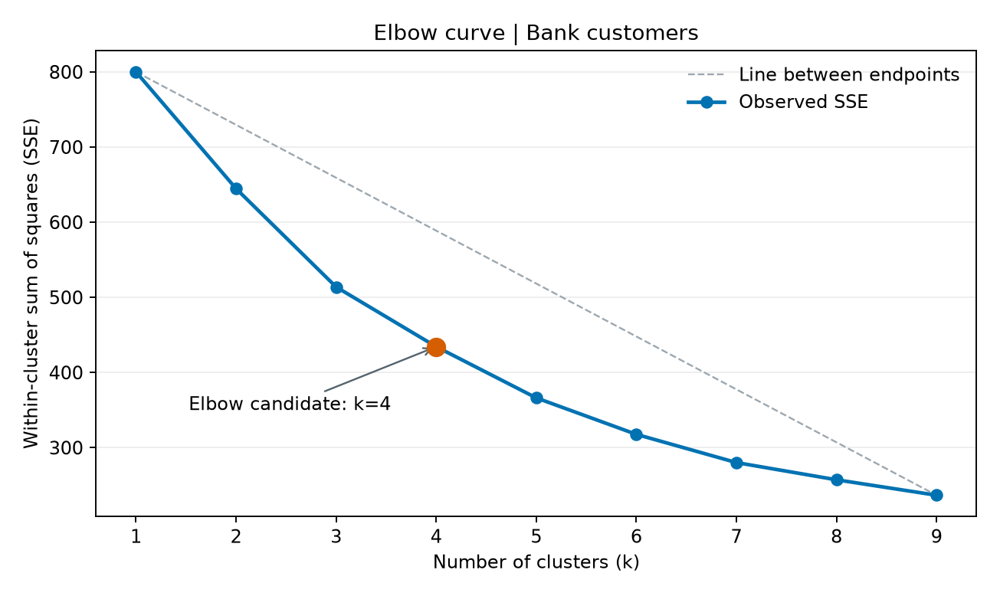
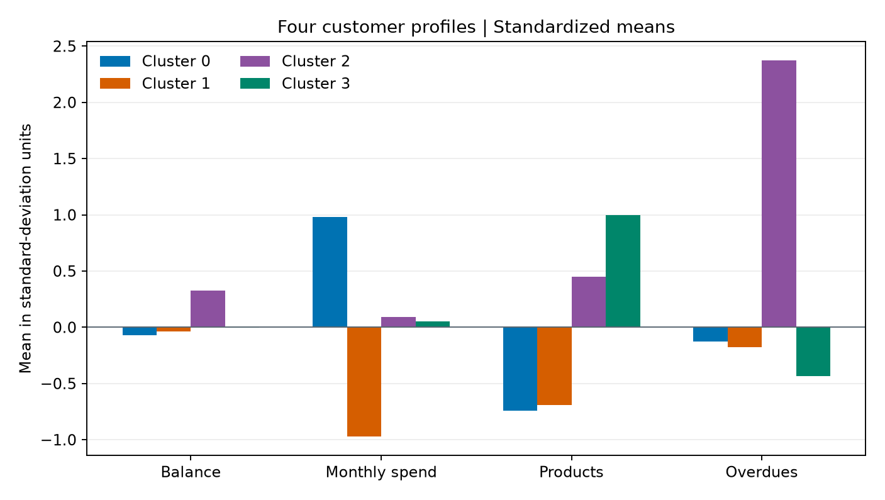
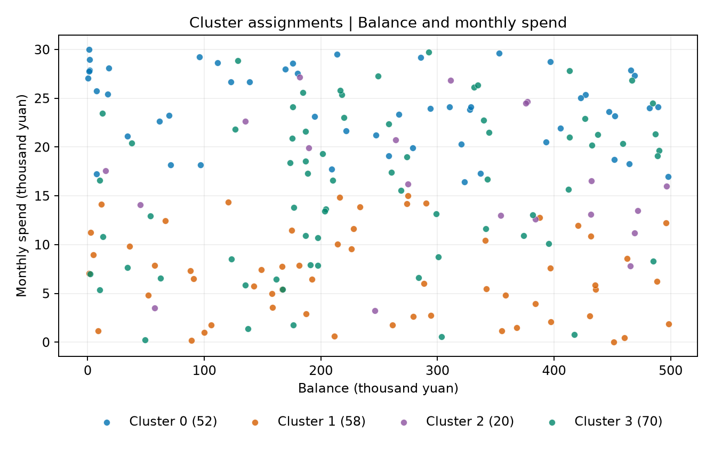
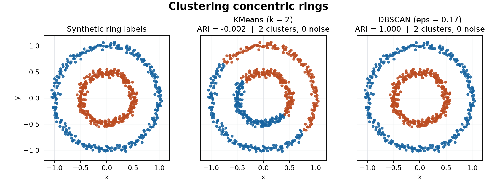

# 课堂实践进度报告九 · 聚类客户分群

## 1. 检查点完成情况

**检查点 1｜标准化与四簇人数。** 使用教师仓库的 200 条教学用银行客户记录。选取余额、月均消费、产品数、历史逾期次数，分别描述资金规模、消费活跃度、产品使用和还款记录。四列均无缺失。经 StandardScaler 标准化后，用 K-means（k=4、random_state=42、n_init=10）得到 **簇 0 为 52 人、簇 1 为 58 人、簇 2 为 20 人、簇 3 为 70 人**，合计 200 人，与教师范例的逐簇人数及均值一致至其报告精度。源 CSV 的 Git blob 与教师仓库一致，簇编号写入 DataFrame 的 cluster 列并另存为分配表。[教师范例输出](https://github.com/thiswind/ai-programming-2026-demo/blob/c5d35a9b9164ff0fb1e08c276c3d53a95b2c3875/lesson09/cluster_output.txt) · [分配表](results/assignments.csv)

**检查点 2｜肘部图。** 对 k=1 到 9 逐个计算 SSE，结果依次为 800.00、644.69、513.81、434.33、366.21、317.67、280.11、257.21、236.66。曲线逐渐变缓。各点到首尾连线的垂距在 **k=4** 时最大，且选四群能够保留四种可解释的经营画像，因此取 k=4。曲线的弯折较缓，k=4 是本次作业的工作取值。

**检查点 3｜画像、中文命名与建议。** 表中是原量纲均值，图中以全样本平均水平为零点，用标准差为单位比较各特征。

| 簇 | 人数 | 余额（元） | 月均消费（元） | 产品数 | 历史逾期次数 | 中文业务命名与建议 |
|---|---:|---:|---:|---:|---:|---|
| 0 | 52 | 238,836.39 | 23,983.04 | 2.81 | 0.46 | **高消费少产品型**。月均消费四簇最高，适合结合消费场景介绍权益。 |
| 1 | 58 | 243,863.76 | 6,984.69 | 2.91 | 0.41 | **低消费少产品型**。以账户服务和低频触达为主，观察活跃度变化。 |
| 2 | 20 | 298,908.57 | 16,233.57 | 5.45 | 3.05 | **高余额多逾期型**。优先提供还款提醒和服务支持，营销或授信需结合独立评估。 |
| 3 | 70 | 248,964.81 | 15,927.82 | 6.67 | 0.14 | **多产品低逾期型**。产品数最多、历史逾期最少，适合做好产品续期和存量服务。 |

## 2. 遇到的问题与解决方式

直接把四列原始数值送入 K-means 时，余额约占四列原量纲方差之和的 99.67%，平方距离主要由余额决定。四簇的余额均值从低到高约为 3.82 万、17.94 万、30.29 万、44.01 万元，其月均消费却都在 1.45 万至 1.60 万元之间。用 StandardScaler 把各列转换到均值为 0、方差为 1 的尺度后，消费、产品数和逾期次数才在画像中呈现出清楚的差异。两种方案的簇分配 ARI 仅为 0.0063。两套均值表均保存于计算明细。[计算明细](results/metrics.json)

未标准化的画像如下，按余额均值排序。标准化结果的原量纲均值见检查点 3。两次训练的簇编号各自独立。

| 未标准化簇 | 人数 | 余额（元） | 月均消费（元） | 产品数 | 历史逾期次数 |
|---|---:|---:|---:|---:|---:|
| 2 | 42 | 38,232.17 | 14,549.87 | 3.95 | 0.74 |
| 0 | 57 | 179,367.20 | 15,460.11 | 4.75 | 0.35 |
| 3 | 46 | 302,864.61 | 16,034.21 | 4.70 | 0.57 |
| 1 | 55 | 440,142.62 | 15,671.90 | 4.33 | 0.76 |

## 3. 自主实践完成度自查

| 任务 | 进度 | 核对项 |
|---|---|---|
| 加入开户月数重做画像 | 已实跑 | 五特征均值、人数和原簇到新簇的交叉表 |
| 三种随机种子重跑 | 已实跑 | random_state 取 42、0、7，比较 SSE、画像和 ARI |
| 两特征散点着色 | 已实跑 | 横轴余额，纵轴月均消费，图例按四簇标注人数 |
| AI 使用记录 | 已记录 | 关键指令、实验核对结果和本人查阅记录 |

**加入开户月数。** 固定 k=4、种子 42 和初始化次数，把开户月数（account_age_months）与原四列一起标准化。新画像如下，开户月数列是新增特征的原量纲均值。

| 新簇 | 人数 | 余额（元） | 月均消费（元） | 产品数 | 历史逾期次数 | 开户月数 | 画像 |
|---|---:|---:|---:|---:|---:|---:|---|
| 0 | 62 | 198,286.45 | 16,371.04 | 2.42 | 0.39 | 174.61 | 开户久、少产品 |
| 1 | 49 | 286,448.28 | 14,578.05 | 6.59 | 0.16 | 174.71 | 开户久、多产品、少逾期 |
| 2 | 64 | 257,262.51 | 14,678.98 | 4.73 | 0.25 | 45.33 | 相对短开户期、中等产品数 |
| 3 | 25 | 286,990.86 | 16,922.61 | 4.60 | 2.84 | 95.12 | 较多历史逾期 |

新旧分群的 ARI 为 **0.2926**。原来的高消费和低消费少产品群各有 32、30 人进入新簇 0，消费高低在这里让位于开户时间和产品数。原高余额多逾期群有 19/20 人进入新簇 3。加开户月数后，画像可以支持按开户阶段做服务，也会弱化原有的消费分层。

**三种随机种子。** 保持特征、标准化、k=4 和 n_init=10 不变。用调整兰德指数（ARI）比较客户划分，簇编号顺序变化不影响这一指标。

| random_state | 人数（按该次簇编号 0 到 3） | SSE | 与种子 42 的 ARI |
|---:|---|---:|---:|
| 42 | 52 / 58 / 20 / 70 | 434.330 | 1.0000 |
| 0 | 72 / 52 / 55 / 21 | 433.942 | 0.5613 |
| 7 | 54 / 22 / 73 / 51 | 433.824 | 0.4536 |

三次的 SSE 相差不到 0.51，但客户归属有明显变化。三次都识别出约 20–22 人、平均历史逾期约 3 次的小群。种子 0 和 7 的高产品组月均消费约 2.06 万和 2.20 万元，种子 42 对应画像约 1.59 万元。高逾期画像相对稳定，其余客群的边界受初始化影响。[各次画像](results/metrics.json)

**散点图。** 余额和月均消费均以千元显示。簇 0 多出现在高消费区，簇 1 多出现在低消费区，各色仍有交叠。簇分配使用四列，图上只显示其中两列。

## 4. 独立研究

**MapReduce 并行 k-均值。** 在每轮迭代中，把当前质心发给各个分片。Map 在本地把样本分到最近质心，并按簇汇总各特征之和和样本数。Reduce 对同一簇的各分片结果累加，再用总和除以总人数得到新质心。这样大批量的距离计算可以并行，节点间传输的主要是每簇的局部汇总。每轮仍要同步新质心，多轮迭代会产生通信开销。课程的 200 条数据用单机就足够。[MapReduce 原论文](https://research.google/pubs/mapreduce-simplified-data-processing-on-large-clusters/)

**环形数据与 DBSCAN。** 生成 600 个内外双环样本（factor=0.5、noise=0.035、random_state=42）。K-means 依据到质心的距离将平面切成两片，两片都含有内圈点和外圈点，与生成标签的 ARI 为 −0.0016。DBSCAN 按邻域密度连接样本，在 eps=0.17、min_samples=5 时找回两个环，噪声点为 0，ARI 为 1.0000。结论取自这组模拟数据和参数。[运行代码](research.py)

**轮廓系数。** 对单个样本，用 a 表示其到本簇其他样本的平均距离，用 b 表示其到最近其他簇的平均距离，计算 (b − a) / max(a, b)，再对样本取平均。越接近 1，簇内越紧、簇间越分离。对相同标准化数据实跑得到 k=4 为 **0.2275**、k=3 为 0.2281。在 k=2 到 9 的候选中，k=7 的得分最高，为 0.2642。肘部和业务画像支持取四群，轮廓分数提示不同客群之间仍有重叠。[scikit-learn 轮廓系数文档](https://scikit-learn.org/stable/modules/generated/sklearn.metrics.silhouette_score.html)

## 5. AI 使用记录摘要

**关键指令原文**

> 补充一下，这个是课堂老师的那个官方仓库，你自己找一下对应的看一下。还有，我在文件夹里新增了一个课堂演示的仓库，就是当次课堂的你多注意一下，看一下缺什么再跟我要

**任务与提示词。** 任务是找到教师案例与原始数据，结合课程指南完成四簇分群、选 k、客群画像、增加开户月数和三种子对比。实验思路参考课堂演示包供 Trae 使用的提示词，重点是比较标准化前后的画像，用肘部图和轮廓系数分别检查 k 的取值。[教师案例](https://github.com/thiswind/ai-programming-2026/tree/e8f8d9bfb7ba30c91727601a74b35f242e3daa9e/lessons/09-clustering)

**实验核对。** 原始 CSV 的哈希与教师仓库一致。分配表汇总为 52 / 58 / 20 / 70，与教师范例逐簇一致。肘部图包含 k=1 到 9 的九个 SSE 值，图中标出 k=4。画像表中的月均消费、产品数和历史逾期次数为四个中文命名提供依据。[计算明细](results/metrics.json)

**本人验证。** 我把报告从头到尾看了一遍。作业的三个核对项集中在第一节，分别是四簇人数、标注 k=4 的肘部图，以及四个中文命名和对应的画像均值。

## 6. 本课一句话收获

标准化决定谁在距离计算里说了算，特征选择决定最后分出的客群能回答什么业务问题。
